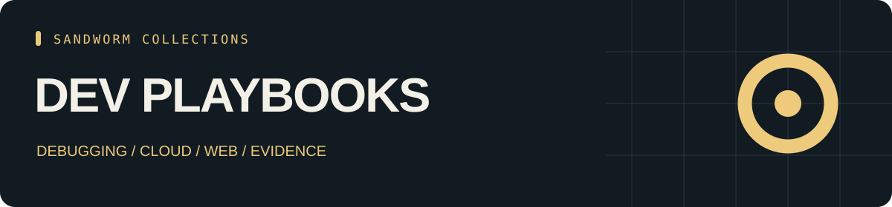

<p align="center"></p>

<p align="center"><b>30 skill entries · 15 tools · 26 source repositories</b></p>

# Sandworm Dev Playbooks

Developer workflows for debugging, cloud, frontend, coding agents, and evidence-backed reviews, with original playbooks and report templates.

คู่มือทำงานสำหรับนักพัฒนา: debugging, cloud, frontend, coding agents พร้อม playbook และแม่แบบรายงานที่เขียนขึ้นเอง

[ภาษาไทย](README.th.md) · [Skills](CATALOG.md) · [Tools](TOOLS.md) · [Start here](docs/start-here.md) · [Sources](SOURCES.md) · [Collection hub](https://github.com/Sandworm-Lazarus/sandworm-arsenal)

## What is inside

| Track | Entries |
| --- | ---: |
| Engineering | 8 |
| Cloud / DevOps | 15 |
| Web / Frontend | 7 |

| Tool category | Projects |
| --- | ---: |
| Visual workflows | 3 |
| Chat workspaces | 2 |
| Document ingestion | 5 |
| Image workflows | 2 |
| Coding agents | 3 |

## Use the collection

Browse the pinned source links and use the task paths in [Start here](docs/start-here.md). The offline CLI requires Python 3.9+ and no third-party dependencies.

```bash
git clone https://github.com/Sandworm-Lazarus/sandworm-dev-playbooks.git
cd sandworm-dev-playbooks
python3 scripts/arsenal.py search "" --json
python3 scripts/arsenal.py tools "" --json
python3 scripts/arsenal.py stats
python3 scripts/arsenal.py check
```

On Windows, use `py -3` if `python3` is unavailable.

## Evidence and reuse

Entry and Overview labels retain the inspection scope from the original research. Tool records are README overviews. No upstream installation, runtime certification, or benchmark result is claimed. [Review coverage](docs/review-status.md) records this collection's counts.

Original summaries, artwork, CLI and guides are [MIT licensed](LICENSE). Linked projects retain their own licenses; inspect [source/license notes](SOURCES.md) before copying or deploying external packages. This collection contains original curation and links, not upstream bundles.

## Related collections

- [AI Toolbox](https://github.com/Sandworm-Lazarus/sandworm-ai-toolbox)
- [Agent Skills](https://github.com/Sandworm-Lazarus/sandworm-agent-skills)
- [Cyber Arsenal](https://github.com/Sandworm-Lazarus/sandworm-cyber-arsenal)
- [LLM Lab](https://github.com/Sandworm-Lazarus/sandworm-llm-lab)

Selections overlap where tools support multiple tasks. Do not add collection counts together to infer a unique total.

## Original working materials

- [Three original playbooks](playbooks/review-agent-extension.md) for extension review, evidence-backed diffs and model comparison.
- [Five report templates](templates/README.md) for findings, threat models, model evals, extension reviews and detection rules.
