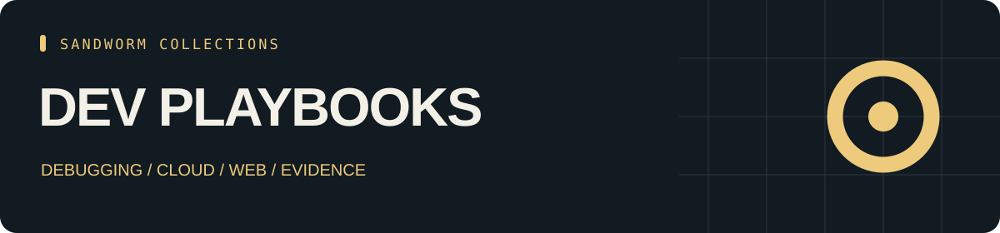

<p align="center"></p>

<p align="center"><b>30 skill entries · 17 tools · 28 source repositories</b></p>

# Sandworm Dev Playbooks

คู่มือทำงานสำหรับนักพัฒนา: debugging, cloud, frontend, coding agents พร้อม playbook และแม่แบบรายงานที่เขียนขึ้นเอง

[English](README.md) · [Skills](CATALOG.md) · [Tools](TOOLS.md) · [Start here](docs/start-here.md) · [Sources](SOURCES.md) · [หน้ารวมทุกคลัง](https://github.com/Sandworm-Lazarus/sandworm-arsenal)

คลังนี้มีสกิล 30 entries และเครื่องมือ 17 ตัว พร้อมลิงก์ที่ตรึง commit และคำอธิบายการใช้งาน อ่าน [เส้นทางเริ่มต้น](docs/start-here.md) เพื่อเลือกตามโจทย์

## ค้นหาและตรวจข้อมูล

ใช้ Python 3.9+ โดยไม่ต้องติดตั้ง dependencies เพิ่ม

```bash
python3 scripts/arsenal.py search "" --json
python3 scripts/arsenal.py tools "" --json
python3 scripts/arsenal.py stats
python3 scripts/arsenal.py check
```

## ระดับการตรวจ

Entry หมายถึงเคยอ่านไฟล์ entry ในงานรีเสิร์ชต้นทาง ส่วน Overview หมายถึงตรวจ frontmatter และเนื้อหาช่วงต้น เครื่องมือเป็นการตรวจภาพรวม README ไม่ได้รันทดสอบแพ็กเกจต้นทาง ดู [coverage](docs/review-status.md) ของคลังนี้ได้

งานคัดสรรและคู่มือของเราใช้ [MIT](LICENSE) ส่วนผลงานภายนอกใช้ license ของเจ้าของตาม [SOURCES.md](SOURCES.md) การอยู่ในคลังไม่ได้แปลว่าเป็นผลงานที่เราเขียนทั้งหมด

เครื่องมือบางตัวอยู่ได้มากกว่าหนึ่งคลังตามบริบทการใช้งาน จึงไม่ควรนำจำนวนจากทุก repo มาบวกเป็นจำนวนโครงการไม่ซ้ำ

## เครื่องมือที่พัฒนาเอง: privacy guard

ใช้ [privacy guard](docs/privacy-guard.md) เพื่อใช้นโยบายปิดบัง field ที่ระบุและข้อความสังเคราะห์แบบ local ด้วย Python standard library โดยไม่มี network requests อ่านขอบเขตและข้อจำกัดในคู่มือก่อนนำผลไปใช้

```bash
printf '%s\n' '{"customer_name":"Synthetic Person","message":"Email nina@example.invalid"}' | python3 scripts/privacy_guard.py json --sensitive-field customer_name
python3 -m unittest discover -s tests -p 'test_privacy_guard.py' -v
```

[ชุดข้อมูลสังเคราะห์](examples/privacy-fixtures.json) เป็นกรณีทดสอบตามนโยบาย ไม่ใช่ผล benchmark ของ Presidio หรือการรับรองว่าค้นพบ PII ครบ

อ่าน [กรณีศึกษาการพัฒนาเครื่องมือของเรา](docs/development-notes/2026-11-11-original-tools.md) สำหรับเหตุผลการออกแบบและหลักฐานการตรวจสอบ
